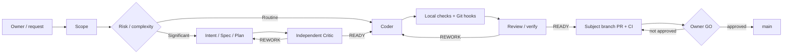
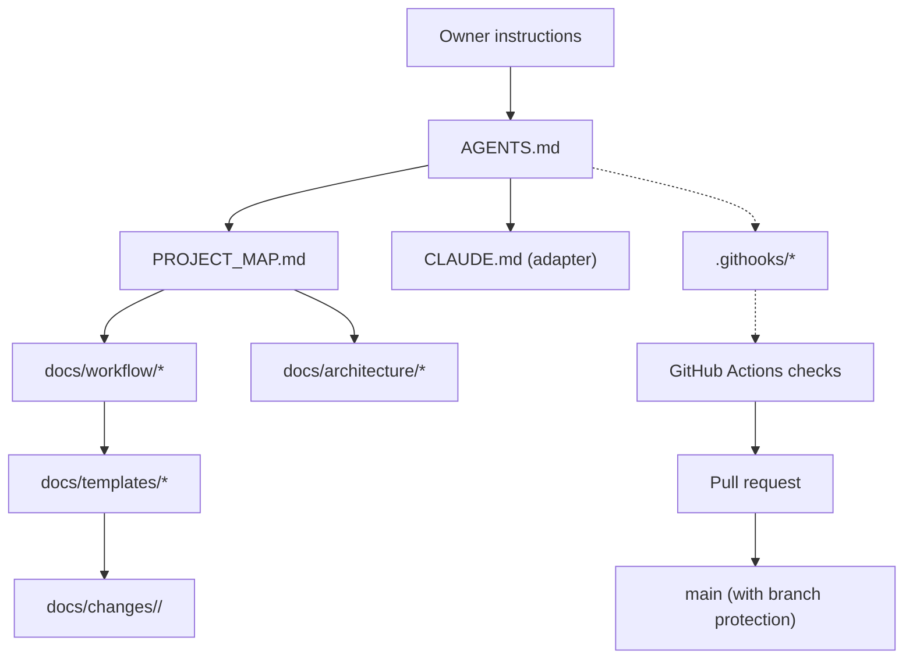
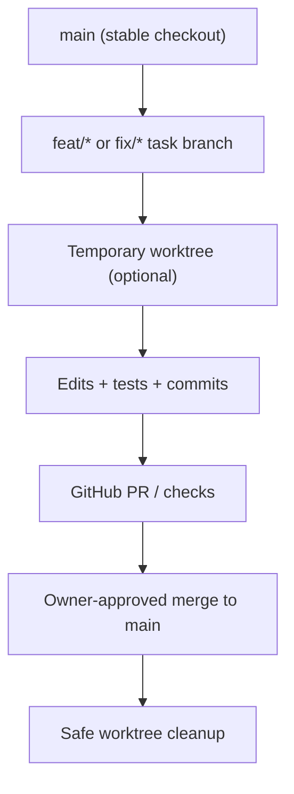

# SDLC Lite — Architecture and Dependency Map

**Status:** proposed v0.1 foundation. This diagram describes the Lite convention, not an installed authorization engine.

## Work flow



Roles are logical; separate people or sessions are used where independent assurance is needed. Hooks are cooperative checks; GitHub branch protections and Owner decisions remain external.

## File and authority dependencies



Solid links indicate documented use/information flow, not programmatic authorization. Dashed links identify supporting checks.

## Directory map

```text
project/
├── AGENTS.md                 # shared AI agent instructions
├── CLAUDE.md                 # Claude-specific entry point
├── PROJECT_MAP.md            # project navigation
├── docs/
│   ├── architecture/         # architecture and decisions
│   ├── workflow/             # procedures and roles
│   ├── security/             # safety boundaries
│   ├── templates/            # copy-on-use documents
│   └── changes/              # optional task artifacts
├── .githooks/                # local Git checks
└── .github/workflows/        # server-side CI checks
```

Application source directories are intentionally not prescribed. There is no Controller, work-block registry, persistent state machine, orchestrator, or automation backend in this kit.

## Git workspace model



`main` stays stable. Temporary worktrees and full clones are different; never remove either without inspecting their actual state.
