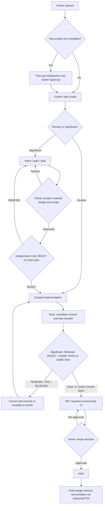
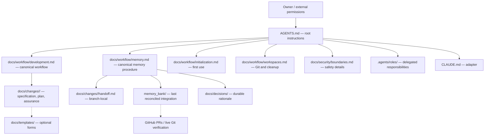

# SDLC Lite — Architecture and File Dependencies

These diagrams visualize the canonical procedures. They are **not** an alternative policy, controller, lifecycle state machine or technical authorization system.

## Development and assurance



The routine path does not require separate independent gates by default. For significant work a `BLOCKED` required Verifier means **no normal assurance clearance**, even if Reviewer is READY. Owner-approved exceptions are explicitly recorded and are not falsely reported as gate PASS. Exact source-vs-PR-head and evidence-only rules are in `docs/workflow/development.md`. Deployment requires separate Owner authorization.

## Knowledge ownership



Arrows show information and references, not runtime permission. **Parallel tasks own separate handoff files; only a designated integration change reconciles the shared memory.**

## File layout

```text
project/
├── AGENTS.md                         # single root agent contract
├── CLAUDE.md                         # runtime adapter, no duplicate rules
├── PROJECT_BRIEF.md                  # repository identity, purpose, constraints
├── PROJECT_MAP.md                    # source-of-truth navigation
├── .agents/roles/                    # six portable subagent briefs
├── memory_bank/                      # last integrated status, not all open branches
│   ├── context.md
│   ├── progress.md
│   ├── decisions.md
│   └── orchestrator-log.md
├── docs/
│   ├── workflow/                     # canonical procedures, including initialization
│   ├── architecture/                 # descriptive diagrams
│   ├── decisions/                    # approved durable design rationale
│   ├── changes/<task>/               # per-task spec/plan/reviews/handoff
│   ├── templates/                    # non-authoritative reusable forms
│   └── security/                     # safety details
├── .githooks/                        # cooperative local Git checks
└── .github/workflows/                # repository CI
```

No trusted Controller, admission store, SQLite, native subagent launcher or autonomous merge/deploy service is included.
