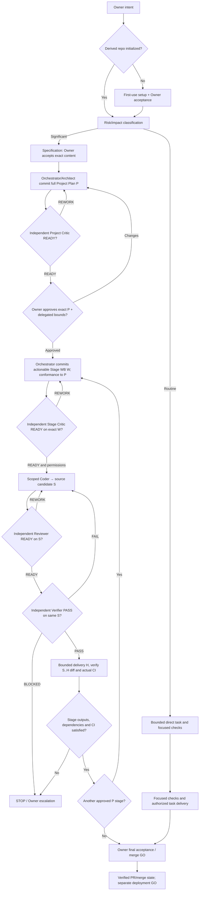
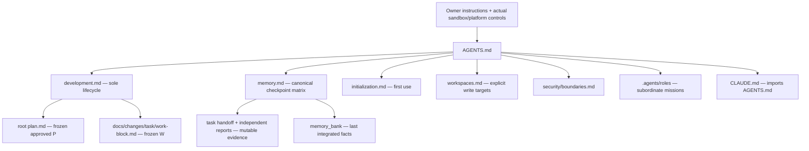

# SDLC Lite — Architecture and File Dependencies

Diagrams **illustrate** `docs/workflow/development.md` and `docs/workflow/memory.md`; they do not authorize operations or define competing gates.

## Project definition and autonomous stage execution



Project Critic READY is **not** Owner approval; Stage Critic READY is **not** a new Owner approval or OS permission. Within approved P, Orchestrator may make bounded technical decisions and handle ordinary REWORK without repeated Owner gates. Changes outside approved constraints require Owner disposition. A stage does not require merge to progress unless its acceptance criteria explicitly say so.

Working `DELIVERY_READY`, final task `COMPLETE / BLOCKED / CANCELLED`, stage acceptance, PR merge and deployment are different evidenced facts. All P/W/S/H commits and independent reports are separate subjects.

## Source hierarchy and memory



Arrows express reading/navigation only. Harness-native agents execute tasks; role labels and Skills do not install runtime privileges. Separate task branches own handoffs; shared memory is reconciled only by an authorized integration writer.

## Layout

```text
project/
├── AGENTS.md                 # one root contract
├── CLAUDE.md                 # import, not another policy
├── PROJECT_BRIEF.md          # identity and product constraints
├── PROJECT_MAP.md            # navigation
├── plan.md                   # approved project P for significant work, immutable
├── .agents/roles/            # portable role briefs
├── docs/
│   ├── workflow/             # canonical procedures
│   ├── architecture/         # descriptive diagrams
│   ├── decisions/            # accepted rationale
│   ├── changes/<task>/       # reviewed W, separate handoff/reports
│   ├── templates/            # non-authoritative forms
│   └── security/             # security boundaries
├── memory_bank/              # reconciled integrated facts
├── .githooks/                # optional conventional hooks
└── .github/workflows/        # structural CI and bounded first-use guard
```

Previously approved legacy `docs/changes/<task>/plan.md` preserve original provenance. Lite does not contain a Controller, SQLite authority registry, hook installer, native agent runtime, skill-fetcher or automated merge/deploy.
