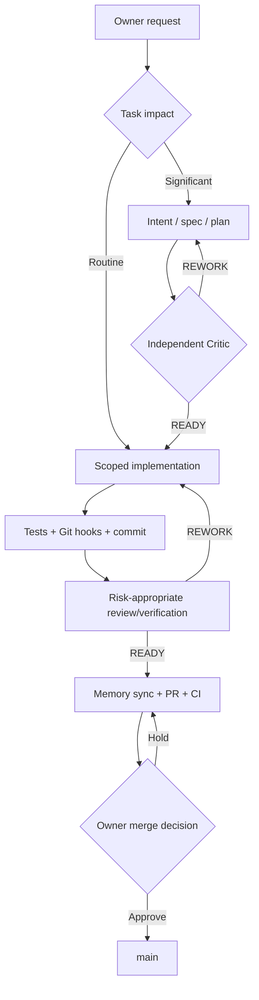
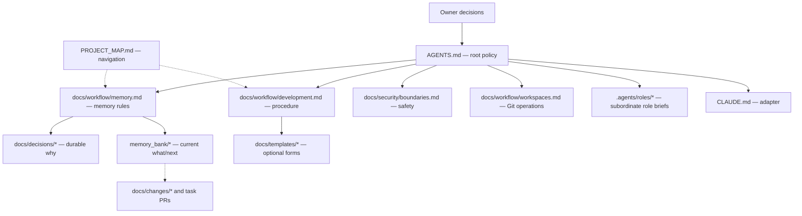

# SDLC Lite — Architecture and File Dependencies

These are *documentation and execution conventions*, not an installed controller or autonomous orchestration engine.

## Development flow



The exact source candidate and PR head may differ when follow-on documentation is committed; the canonical rule is in `docs/workflow/development.md`. Deployment is a separate Owner decision. Local hooks do not enforce actual OS or GitHub permissions.

## One-source-of-truth navigation



Arrows show document references and responsibilities; they do not grant permissions.

## Folder map

```text
project/
├── README.md
├── PROJECT_BRIEF.md                  # product purpose and constraints
├── PROJECT_MAP.md                    # navigation only
├── AGENTS.md                         # single root operating contract
├── CLAUDE.md                         # runtime adapter
├── .agents/roles/                    # 6 portable role briefs
├── memory_bank/
│   ├── context.md                    # current handoff snapshot
│   ├── progress.md                   # recent verified milestones
│   ├── decisions.md                  # ADR index
│   └── orchestrator-log.md           # material coordination log
├── docs/
│   ├── architecture/                 # diagrams
│   ├── decisions/                    # durable engineering decisions
│   ├── workflow/                     # canonical development/memory/Git rules
│   ├── security/                     # canonical security detail
│   ├── templates/                    # optional forms
│   └── changes/                      # task spec/plan/evidence, as needed
├── .githooks/                        # cooperative Git checks
└── .github/workflows/                # CI checks
```

No state machine, duplicate SDD/lifecycle policy, registry, database or background agent is installed.
