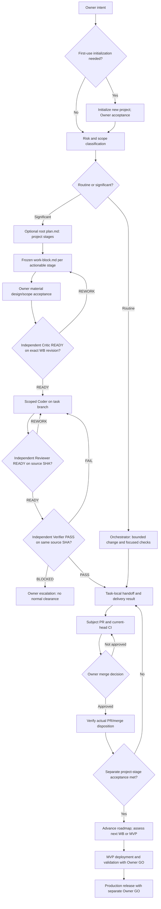
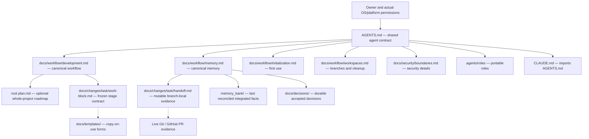

# SDLC Lite — Architecture and File Dependencies

Diagrams **illustrate** `docs/workflow/development.md` and `docs/workflow/memory.md`; they do not introduce a second policy, orchestration runtime or technical authorization.

## Project roadmap and delivery



`DELIVERY_READY` is only a **working phase** in handoff; **final task closeout** is `COMPLETE / BLOCKED / CANCELLED` and can occur before PR merge. Project-stage acceptance, merge, MVP deployment/validation and production are separate evidenced facts with their own authorization.

## Documentation ownership



Arrows are references, not runtime permissions. Codex, Claude Code and other harnesses perform native orchestration. Parallel tasks have separate handoffs; shared memory is updated by an authorized integration writer only.

## File layout

```text
project/
├── AGENTS.md                      # sole shared agent contract
├── CLAUDE.md                      # @AGENTS.md import, no extra policy
├── PROJECT_BRIEF.md               # project identity and constraints
├── PROJECT_MAP.md                 # navigation
├── plan.md                        # optional ONE project roadmap
├── .agents/roles/                 # logical role briefs
├── memory_bank/                   # reconciled integrated summary
│   ├── context.md
│   ├── progress.md
│   ├── decisions.md
│   └── orchestrator-log.md
├── docs/
│   ├── workflow/                  # canonical procedures
│   ├── architecture/              # descriptive diagrams only
│   ├── decisions/                 # accepted design rationale
│   ├── changes/<task>/            # frozen WB, separate handoff and reports
│   ├── templates/                 # non-authoritative forms
│   └── security/                  # security details
├── .githooks/                     # optional conventional Git hooks
└── .github/workflows/             # structural CI
```

Previously approved `docs/changes/<task>/plan.md` are historical **task-specific implementation plans** with original exact Critic provenance—not a competing root roadmap. There is no Controller, SQLite, admission service, custom dispatcher/adapter, skill-fetcher, native agent installer or autonomous merge/deploy system.
